# Mini Web Editor

A book editor that runs in the browser. Open a Word manuscript or start a blank book, turn it into a clean, well-structured book, preview it on phone and tablet screens, and export it as a Word file. Nothing is installed and nothing leaves the browser: books are saved on the device, and every file is built on the page itself.


**Try it:**

- [`samples/the-rain-ledger.docx`](samples/the-rain-ledger.docx) is a short Word manuscript with a title, a copyright line, chapters with subtitles, footnotes, a scene break and an illustration. Open it with **Open Word file**.
- [`samples/the-rain-ledger.epub`](samples/the-rain-ledger.epub) is the book the editor built from it. It passes [EPUBCheck](https://www.w3.org/publishing/epubcheck/) 5.2.1 with 0 errors and 0 warnings.

## Contents

- [Features](#features)
- [Quick start](#quick-start)
- [What it is built with](#what-it-is-built-with)
- [How it works](#how-it-works)
  - [Overview](#overview)
  - [The document](#the-document)
  - [Opening a Word file](#opening-a-word-file)
  - [Suggestions](#suggestions)
  - [Generated pages](#generated-pages)
  - [Footnotes](#footnotes)
  - [Spelling and grammar](#spelling-and-grammar)
  - [The preview](#the-preview)
  - [The EPUB](#the-epub)
  - [The Word export](#the-word-export)
  - [Saving](#saving)
  - [Images](#images)
  - [Fonts and themes](#fonts-and-themes)
  - [Phones](#phones)
- [Project structure](#project-structure)
- [Connecting a backend](#connecting-a-backend)
- [Extending the editor](#extending-the-editor)
- [Testing](#testing)
- [Known limits](#known-limits)
- [Licenses](#licenses)

## Features

### Books

The start page lists every book saved in this browser, newest first. **New book** starts a blank one, and **Open Word file** turns a `.docx` file into a new book. Opening a file never changes an existing book.

### Opening Word files

The import keeps what a book needs and cleans up what it doesn't:

- **Kept:** headings, bold, italic and underline, alignment, images, lists, footnotes and endnotes, and Word's Subtitle style.
- **Cleaned up:** fonts, sizes and colours; tabs used as indents; blank lines used as spacing; page breaks.
- **Moved to their own pages:** title lines, a by-line and copyright lines go to the Title page and Copyright forms. A typed table of contents is taken out, because the book makes its own.
- **Kept as scene breaks:** occasional blank lines between paragraphs, as long as the manuscript has few of them.

A notice at the top of the text says what was moved or couldn't be kept.

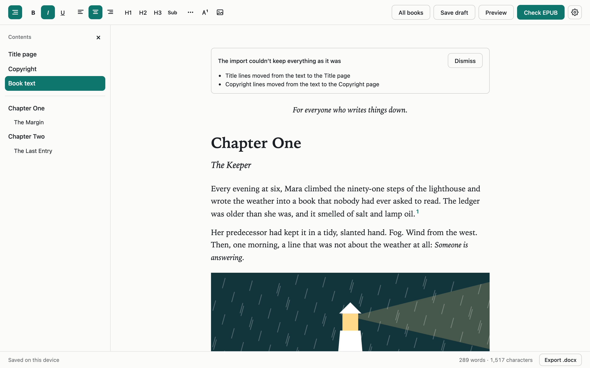

### Suggestions

Some things the import can't be sure of, so it asks. Each suggestion can be accepted or rejected on its own, or all at once:

- **Chapter headings:** plain lines that read like chapters, such as `Chapter 3`, `IV` or `Prologue`.
- **Chapter subtitles:** a short line, set apart by italics, bold or centring, right under a chapter heading.
- **Alignment:** a long paragraph aligned differently from the rest of the book.

Suggestions are saved with the book until they are reviewed, and they never reach the preview or an export.

### Formatting

| Action           | Mac   | Windows / Linux |
| ---------------- | ----- | --------------- |
| Bold             | ⌘B    | Ctrl+B          |
| Italic           | ⌘I    | Ctrl+I          |
| Underline        | ⌘U    | Ctrl+U          |
| Align left       | ⌘⇧L   | Ctrl+Shift+L    |
| Align center     | ⌘⇧E   | Ctrl+Shift+E    |
| Align right      | ⌘⇧R   | Ctrl+Shift+R    |
| H1, H2, H3       | ⌘⌥1–3 | Ctrl+Alt+1–3    |
| Chapter subtitle | ⌘⌥4   | Ctrl+Alt+4      |
| Save draft       | ⌘S    | Ctrl+S          |

The toolbar also adds scene dividers, footnotes and images.

### Chapter subtitles

A subtitle is another name for a chapter, as in *Chapter One* with the subtitle *The Keeper*. It is not a section of its own. Mark the line under a heading with **Sub**. The book shows the subtitle under its heading, and the contents and the Contents panel list the title only. A subtitle line with no heading above it is ordinary text in the book.

### Scene dividers

**Add divider** (the three dots) puts a scene break at the cursor. Click a divider to select it, and press Delete to remove it. One style applies to the whole book, chosen in the settings: a line, `* * *` or `❦`.

### Footnotes

**Add footnote** (A¹) puts a numbered footnote at the cursor and opens a box for its note. Click a footnote's number to edit or delete it. Numbers follow the footnotes' order, so adding one renumbers the rest. Every note is listed after the text, and each number there leads back to its footnote. A footnote left empty is removed when the cursor moves away from it.

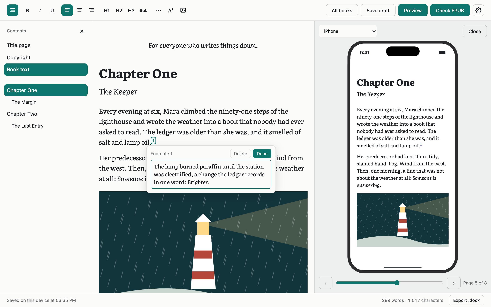

In the book, each footnote links to its note on a Notes page at the end, and the note's number links back.

### Spelling and grammar

English books get a red wavy underline under spelling and grammar mistakes as the author writes. Click one to see what's wrong, pick a fix, ignore it, or add the word to the book's dictionary. The checker is [Harper](https://github.com/automattic/harper), which runs in the browser, so no text is sent anywhere.

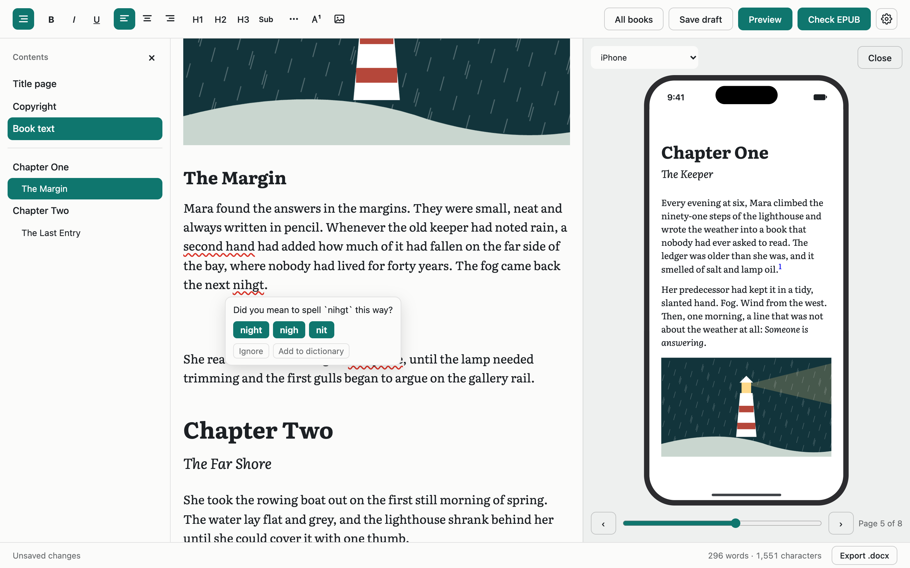

- **Dialect:** American, British, Canadian, Australian or Indian English, or off. It starts on the browser's region.
- **Per book:** the dictionary (character names, invented words) and the ignored mistakes are saved with each book.
- **English only:** a book whose text isn't English is never checked.
- **Tuned for fiction:** rules that fiction breaks on purpose are off, such as quotes left open across paragraphs of dialogue, swearing, and "gonna". So are style opinions such as sentence length and the Oxford comma.
- **One set of underlines:** while the check is on, the browser's own spell check is off.

### Generated pages

The book gets a title page, a copyright page and a table of contents, in that order, each starting on its own page. None of them is part of the text the author edits:

- **Title page and Copyright** in the left panel open forms in place of the text. Lines the import recognised fill them in.
- **The table of contents** is built from the headings and comes straight after the copyright page, before any of the book's text.

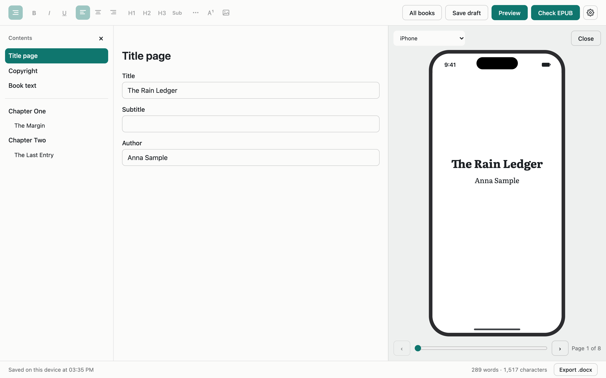

### Preview

**Preview** shows the book as a reader would see it, paged like a reading app, in a phone or tablet frame: iPhone, iPad, Samsung Galaxy A or Samsung Galaxy Tab. On a wide screen it sits beside the text and follows every edit.

<p>
  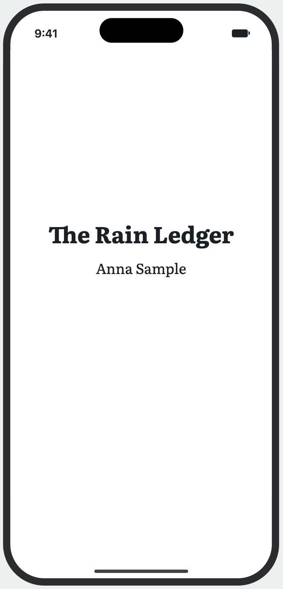
  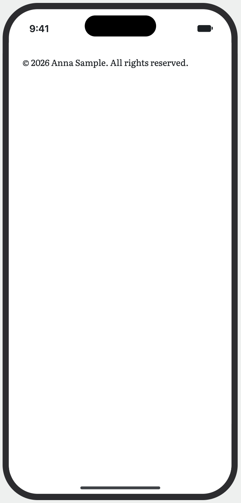
  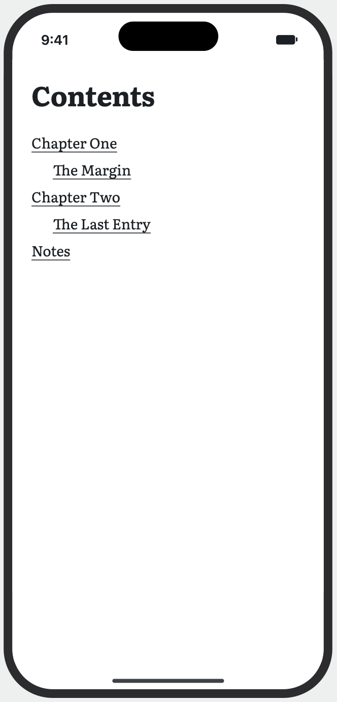
  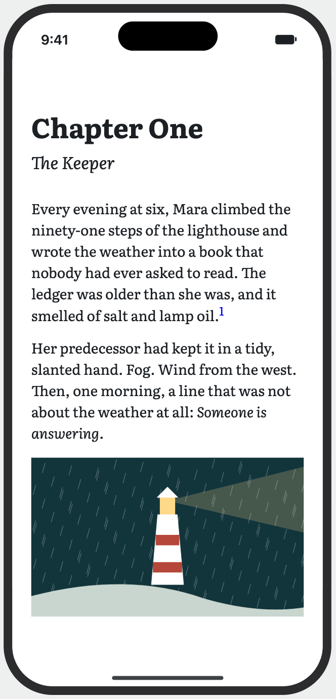
  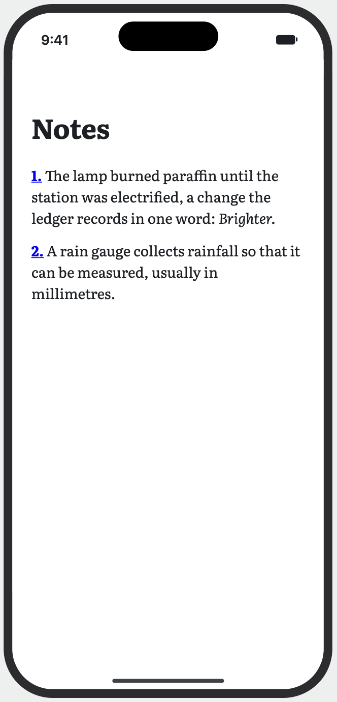
</p>

### Export

**Export .docx** in the bottom bar downloads the book as a Word file. It includes the generated pages, real Word footnotes, the headings as Word headings, and subtitles in Word's Subtitle style. Opening the exported file again brings back its headings, subtitles and footnotes.

**Check EPUB** builds the book's EPUB, so its output can be checked in a reading app or with EPUBCheck. It is there only while the app runs with `npm run dev`. Production builds leave the EPUB code out, and the build fails if it slips in (see [The EPUB](#the-epub)).

### Settings

The cog in the top right holds the book font, the scene divider style, the spelling dialect and the theme. The font, divider and dialect belong to the book. The theme belongs to the browser.

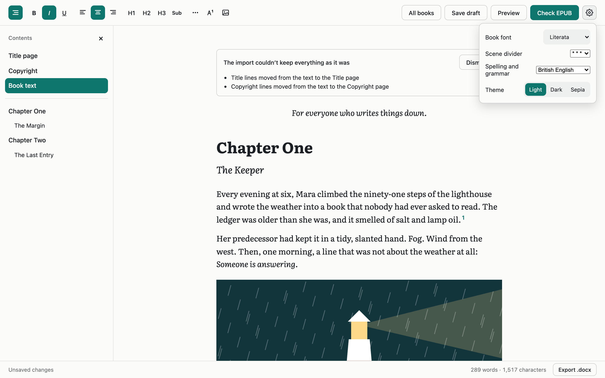

### Themes

Light, Dark and Sepia. The editor follows the device until the author chooses.

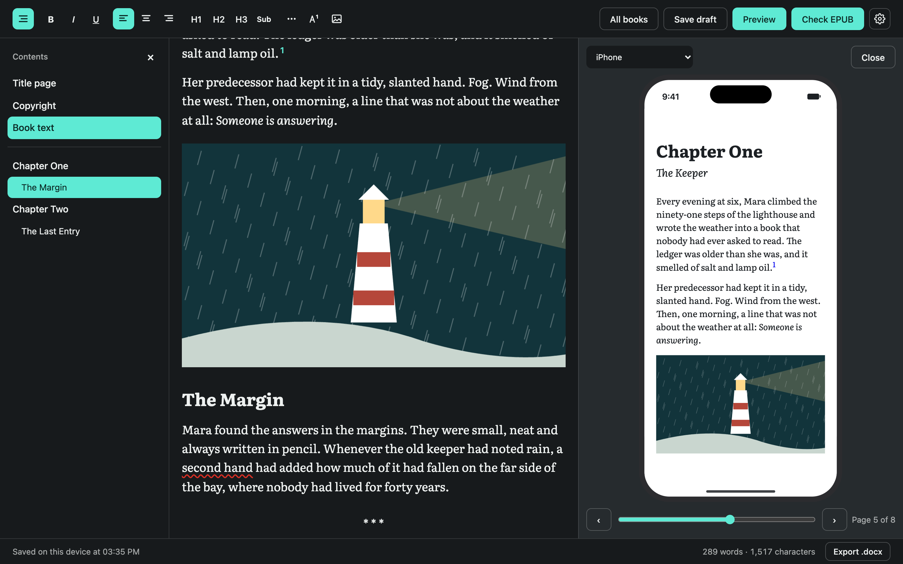

### Also included

- **Paste** from Word, Google Docs, Pages or the web, keeping the formatting.
- **Status bar** along the bottom: whether the book is saved, its word and character counts (notes included), and **Export .docx**.
- **Contents panel** on the left: Title page, Copyright, Book text, and every chapter and section. Click one to go there.

## Quick start

Requires Node.js. The project was developed on Node 24.

```bash
npm install
npm run dev
```

Open <http://localhost:3000>.

| Command         | What it does                                                  |
| --------------- | ------------------------------------------------------------- |
| `npm run dev`   | Starts the development server, with **Check EPUB**            |
| `npm run build` | Creates a production build, then checks that it has no EPUB code |
| `npm start`     | Serves the production build                                   |
| `npm test`      | Runs the unit tests                                           |
| `npm run lint`  | Runs ESLint                                                   |

To see how the import handles a folder of Word files, run `npx tsx scripts/import-report.ts <folder>`. It prints counts only, such as headings, suggestions and notices per file, and never the text.

## What it is built with

| Layer            | Technology                                                       | Why                                                              |
| ---------------- | ---------------------------------------------------------------- | ---------------------------------------------------------------- |
| App framework    | [Next.js 16](https://nextjs.org), [React 19](https://react.dev)  | The editor runs in the browser; pages stay static                |
| Editor engine    | [ProseMirror](https://prosemirror.net)                           | Structured documents; handles the hard parts of browser editing  |
| Editor framework | [Tiptap 3](https://tiptap.dev)                                   | Ready-made extensions and React bindings on top of ProseMirror   |
| Word import      | [mammoth](https://github.com/mwilliamson/mammoth.js)             | Reads `.docx` into HTML, keeping meaning rather than looks       |
| Word export      | [docx](https://docx.js.org)                                      | Writes `.docx`, including footnotes and a table of contents      |
| Spelling         | [Harper](https://github.com/automattic/harper) (`harper.js`)     | Grammar and spelling checker that runs in the browser            |
| ZIP              | [fflate](https://github.com/101arrowz/fflate)                    | Small and fast; an EPUB is a ZIP file                            |
| Browser storage  | [idb-keyval](https://github.com/jakearchibald/idb-keyval)        | A very small wrapper around IndexedDB                            |
| Fonts            | [Fontsource](https://fontsource.org)                             | Self-hosted font files, available to the EPUB builder            |
| Language         | TypeScript                                                       |                                                                  |
| Tests            | [Vitest](https://vitest.dev), [jsdom](https://github.com/jsdom/jsdom) | Unit tests                                                  |

There is no CSS framework: styles are plain CSS.

## How it works

### Overview

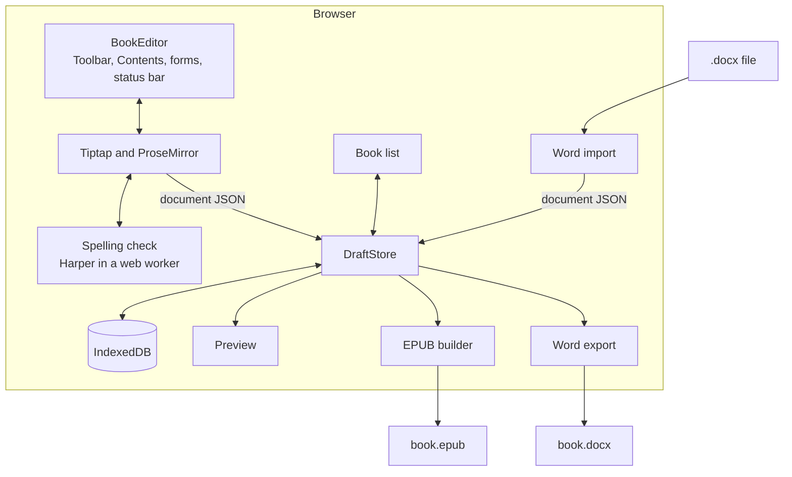

The editor depends on the DOM and IndexedDB, so it never renders on the server. `EditorLoader` loads it with `next/dynamic` and `ssr: false`.

### The document

The schema is in [`src/lib/schema.ts`](src/lib/schema.ts): Tiptap's StarterKit limited to three heading levels, text alignment, and the book's own nodes.

| Kind   | Contents                                                                                       |
| ------ | ---------------------------------------------------------------------------------------------- |
| Blocks | paragraph, heading (1–3), subtitle, bullet list, ordered list, blockquote, scene divider, image |
| Inline | text, hard break, footnote                                                                     |
| Marks  | bold, italic, underline, strike, link                                                          |

- **Subtitle** ([`subtitle.ts`](src/lib/subtitle.ts)) belongs to the heading right above it.
- **Footnote** ([`footnote.ts`](src/lib/footnote.ts)) is a marker that holds its own note: text with emphasis and line breaks. It has no number of its own. The number comes from its place in the book.
- **Suggestions** are hidden attributes on paragraphs and headings, so they move with edits and are saved with the draft.

A saved document is plain JSON:

```json
{
  "type": "doc",
  "content": [
    { "type": "heading", "attrs": { "level": 1 }, "content": [{ "type": "text", "text": "Chapter One" }] },
    { "type": "subtitle", "content": [{ "type": "text", "text": "The Keeper" }] },
    { "type": "paragraph", "content": [
      { "type": "text", "text": "It smelled of salt and lamp oil." },
      { "type": "footnote", "attrs": { "note": [{ "type": "text", "text": "The lamp burned paraffin." }] } }
    ] }
  ]
}
```

### Opening a Word file

[`src/import/`](src/import) turns a `.docx` file into that JSON, in order:

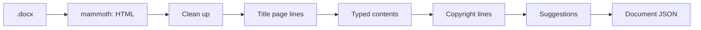

1. **[`docx.ts`](src/import/docx.ts):** mammoth reads the file with a style map that keeps headings, the Title and Subtitle styles and alignment. Images are saved as they arrive.
2. **[`cleanup.ts`](src/import/cleanup.ts):** drops tab indents and page breaks, decides whether blank lines are spacing or scene breaks, and turns footnotes and endnotes into footnote nodes holding their notes.
3. **[`titlePage.ts`](src/import/titlePage.ts), [`contents.ts`](src/import/contents.ts), [`copyright.ts`](src/import/copyright.ts):** move title and copyright lines to their pages and take out a typed table of contents. Each acts only on clear evidence, because the rule is that the import doesn't change the author's words.
4. **[`suggest.ts`](src/import/suggest.ts):** marks likely chapter headings, subtitles and alignment fixes for the author to review.

Blank lines become scene breaks only when they are rare: up to five in a short work, or one per 1,000 words in a long one. More than that means the manuscript uses blank lines for spacing, as plays often do.

### Suggestions

[`suggestions.ts`](src/components/editor/suggestions.ts) draws each suggestion with Accept and Reject buttons, and [`SuggestionReview.tsx`](src/components/editor/SuggestionReview.tsx) offers Accept all and Reject all per kind. Accepting changes the line in one transaction, so a single undo brings it back.

### Generated pages

The title, subtitle, author and copyright details are fields of the draft, edited in [`PageForms.tsx`](src/components/editor/PageForms.tsx). The copyright page's lines are built in [`bookPages.ts`](src/lib/bookPages.ts). The table of contents is built from the headings each time the book is previewed or exported, so it can't go out of date.

### Footnotes

In the editor, [`Footnotes.tsx`](src/components/editor/Footnotes.tsx) shows the selected footnote's box and the list of notes after the text. The box is a small Tiptap editor of its own, limited to one paragraph. The numbers are a CSS counter, so they are always in order.

When the book is built, [`serialize.ts`](src/lib/epub/serialize.ts) numbers the footnotes through the whole book. Each marker links to `notes.xhtml#note-N`, and each note links back to the chapter it came from.

### Spelling and grammar

[`grammarCheck.ts`](src/components/editor/grammarCheck.ts) checks each line on its own, in the background, and remembers the result by the line's text:

- **After the first pass,** only lines that change are checked again, about 600 ms after typing pauses.
- **A word being typed** loses its underline until it is checked again.
- **Changing the dialect, ignoring a mistake or adding a word** rechecks only the lines it affects. A check still running with the old settings is discarded.

[`harper.ts`](src/lib/grammar/harper.ts) loads Harper only when a book is checked. Harper is a WebAssembly file of about 8 MB compressed, which the browser caches after the first time, and it runs in a web worker so typing never waits on it. A failed load is retried on the next check.

### The preview

[`preview.ts`](src/lib/epub/preview.ts) renders the EPUB's own chapters and stylesheet into a sandboxed frame inside the device. Pages are CSS columns one screen wide, and the editor turns them by scrolling the frame. An edit swaps the frame's content without reloading it, so the page doesn't flash.

Firefox ignores CSS column breaks, and Safari doesn't always honour them. So after layout, `fillPageEnds` checks where each chapter and generated page starts. If one starts partway down a page, it fills the rest of that page with empty space. In Chrome the breaks already work, and nothing is added.

### The EPUB

Everything is in [`src/lib/epub/`](src/lib/epub), and runs in the browser.

```text
the-rain-ledger.epub
├── mimetype                  must be first and uncompressed
├── META-INF/container.xml    points to content.opf
└── EPUB/
    ├── content.opf           metadata, file list, reading order
    ├── nav.xhtml             the contents page and the reading app's menu
    ├── toc.ncx               the menu for older e-readers
    ├── book.css              fonts and formatting
    ├── title.xhtml           title page
    ├── copyright.xhtml       copyright page, when there is one
    ├── chapter-001.xhtml     one file per chapter
    ├── notes.xhtml           the notes, when there are footnotes
    ├── fonts/*.woff2
    └── images/*.png
```

- **Chapters:** [`chapters.ts`](src/lib/epub/chapters.ts) starts a new file at each top-level heading. Text before the first heading gets its own file.
- **Headings with subtitles** are written as one `<hgroup>`, with the subtitle marked `role="doc-subtitle"`.
- **Scene dividers** are an `<hr/>` or a centred line, depending on the book's style.
- **Valid XHTML:** Tiptap's HTML output isn't valid XML, so [`serialize.ts`](src/lib/epub/serialize.ts) writes pages directly from the JSON. It escapes text, removes characters that are illegal in XML, and drops unsafe links.

The EPUB code reaches the app only in development. `next.config.ts` swaps [`TeamEpubCheck.tsx`](src/components/editor/TeamEpubCheck.tsx) for an empty component in production builds, and [`scripts/check-no-epub.mjs`](scripts/check-no-epub.mjs) fails the build if EPUB code turns up in the published files anyway. The preview still uses the same chapter builder.

### The Word export

[`src/lib/docx/`](src/lib/docx) writes the book with the `docx` library. It writes the title and copyright pages, a table of contents with its entries already filled in, the headings as Word headings, subtitles in the Subtitle style, footnotes as Word footnotes, and images scaled to the page. The export is loaded only when it is used.

### Saving

[`useAutosave.ts`](src/components/editor/useAutosave.ts) saves every 2 seconds while there are changes, with **Save draft** or ⌘S, when the tab is hidden, and before leaving a book. A failed save shows an error and keeps the change marked as unsaved. Drafts use IndexedDB, because a long book can outgrow `localStorage`. The status says "Saved on this device" because that is exactly what is true.

### Images

Image files are kept out of the document. The document stores an id, and the file sits in a separate IndexedDB database, so autosave stays small however many images a book has. [`images.ts`](src/lib/images.ts) scales each image to at most 1600 px, saves it as JPEG or PNG, and re-encodes it, which removes EXIF data such as a phone photo's location.

### Fonts and themes

The author picks one font for the whole book: Literata, Lora or PT Serif, or Inter or Open Sans. All cover Latin and Cyrillic, and the EPUB embeds only the character sets the book uses. [`scripts/copy-fonts.mjs`](scripts/copy-fonts.mjs) copies them from Fontsource into `public/fonts`.

The theme is stored in the browser, not the book, and a small script in `layout.tsx` applies it before the first paint.

### Phones

Below 768 px, the toolbar moves to the bottom edge, above the keyboard, and scrolls sideways so its buttons stay a size a thumb can hit. On iOS, [`useKeyboardOffset.ts`](src/components/editor/useKeyboardOffset.ts) lifts it above the keyboard using the `visualViewport` API. The preview and the Contents panel cover the page; Esc closes them, and a tap outside closes the Contents panel.

<p>
  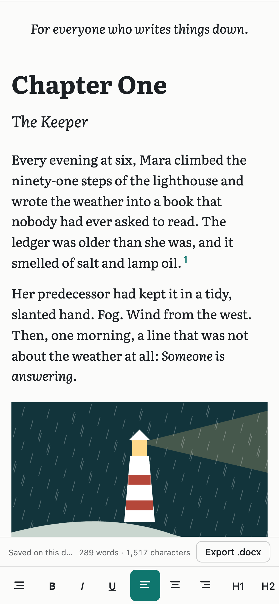
</p>

## Project structure

```text
src/
├── app/                       pages, layout and theme colours
├── components/
│   ├── books/                 the book list
│   └── editor/
│       ├── BookEditor.tsx     loads a book; the main screen
│       ├── Toolbar.tsx        formatting, dividers, footnotes, images
│       ├── Contents.tsx       the left panel
│       ├── PageForms.tsx      Title page and Copyright forms
│       ├── BookPreview.tsx    the device preview
│       ├── Footnotes.tsx      the footnote box and the notes list
│       ├── grammarCheck.ts    spelling and grammar underlines
│       ├── GrammarPopup.tsx   the box for a mistake
│       ├── suggestions.ts     import suggestions in the text
│       ├── SettingsMenu.tsx   the cog menu
│       ├── StatusBar.tsx      save status, counts, Export .docx
│       └── TeamEpubCheck.tsx  Check EPUB (development only)
├── import/                    Word file to document JSON
└── lib/
    ├── schema.ts              what a document can contain
    ├── footnote.ts            the footnote node
    ├── subtitle.ts            the subtitle node
    ├── dividers.ts            scene divider styles
    ├── drafts.ts              DraftStore and browser storage
    ├── grammar/harper.ts      the spelling checker
    ├── epub/                  chapters, EPUB, preview, book stylesheet
    └── docx/                  the Word export
scripts/
├── copy-fonts.mjs             copies fonts into public/fonts
├── check-no-epub.mjs          keeps EPUB code out of production builds
└── import-report.ts           import counts for a folder of Word files
```

## Connecting a backend

The editor and the book list talk only to the `DraftStore` interface in [`src/lib/drafts.ts`](src/lib/drafts.ts):

```ts
export interface DraftStore {
  list(): Promise<Draft[]>;
  load(id: string): Promise<Draft | null>;
  save(draft: Draft): Promise<void>;
  loadImage(id: string): Promise<Blob | null>;
  saveImage(id: string, image: Blob): Promise<void>;
}
```

To store books on a server, implement it over your API and pass it in. No editor code changes. This sketch uses example endpoints:

```ts
const serverDraftStore: DraftStore = {
  list: async () => (await fetch("/api/drafts")).json(),
  load: async (id) => {
    const response = await fetch(`/api/drafts/${id}`);
    if (response.status === 404) return null;
    if (!response.ok) throw new Error("Couldn't load the draft");
    return response.json();
  },
  save: async (draft) => {
    const response = await fetch(`/api/drafts/${draft.id}`, {
      method: "PUT",
      headers: { "Content-Type": "application/json" },
      body: JSON.stringify(draft),
    });
    if (!response.ok) throw new Error("Couldn't save the draft");
  },
  loadImage: async (id) => {
    const response = await fetch(`/api/images/${id}`);
    return response.ok ? response.blob() : null;
  },
  saveImage: async (id, image) => {
    const response = await fetch(`/api/images/${id}`, { method: "PUT", body: image });
    if (!response.ok) throw new Error("Couldn't save the image");
  },
};
```

`load` must throw on a real failure instead of returning `null`. `null` means "no such book", and the editor then shows a message instead of an empty book, so that no autosave can overwrite a book that couldn't be read. A server should also handle the same book open in two tabs, which is last-save-wins today.

## Extending the editor

- **Add a kind of content:** add the extension to `src/lib/schema.ts` **and** a case to `serializeNode` in `src/lib/epub/serialize.ts` and to `blockParagraphs` in `src/lib/docx/index.ts`. Without those, the content's formatting is lost in the EPUB and the Word file.
- **Add a font:** add it to `scripts/copy-fonts.mjs`, run `node scripts/copy-fonts.mjs`, and add it to `FONTS` in [`src/lib/fonts.ts`](src/lib/fonts.ts).
- **Add a toolbar action:** add it to `GROUPS` in `Toolbar.tsx`.
- **Add a preview device:** add it to [`previewDevices.ts`](src/components/editor/previewDevices.ts).
- **Turn a spelling rule on or off:** edit `RULES_OFF` in [`harper.ts`](src/lib/grammar/harper.ts).

## Testing

`npm test` runs 289 unit tests. They cover the Word import (word for word, with footnotes, subtitles, scene breaks and suggestions), paste cleanup, the EPUB and its pages, the preview, the Word export and reading it back, footnotes, word counts, and the spelling check's behaviour.

Beyond those, each feature was exercised in headless Chrome during development:

- importing, suggestions, footnotes, subtitles, dividers, the preview on all four devices, and the spelling check with the real Harper;
- the page filler in headless Firefox, where every chapter started at the top of a page on all four devices;
- the EPUB output with EPUBCheck 5.2.1, with no errors or warnings on a set of real manuscripts.

**Measured in headless Chrome on an Apple Silicon Mac, with a 32,000-word book:**

| Operation                                 | Time         |
| ----------------------------------------- | ------------ |
| First spelling check of the whole book    | About 9 s, in the background |
| Typing a letter while the check runs      | About 20 ms  |

**Not verified yet:**

- Safari.
- Real iPhones and Android phones. Phone layouts were tested in browser emulation.
- Real reading apps. The EPUB was validated with EPUBCheck and viewed in the preview.

## Known limits

- **Books stay on one device** until a backend is connected. Clearing browser data deletes them.
- **The spelling check is English only,** and its first use downloads about 8 MB. If that download starts but never finishes, checking waits rather than giving up.
- **Footnote notes aren't spell-checked;** only the main text is.
- **EPUB output is for checking,** through **Check EPUB** in development. Production builds export `.docx` only.
- **One author field.** Co-authors are saved as a single name.
- **No cover image** yet.
- **SVG images aren't supported.** Formats a browser can't read, such as HEIC in Chrome, are refused with a message.
- **Removed images stay in browser storage** so that undo works.
- **Reading apps may override the font.** That is normal for EPUB.

## Licenses

- The five fonts are licensed under the [SIL Open Font License 1.1](https://openfontlicense.org), which allows embedding them in books. Each font's license is in its folder in `public/fonts/`.
- [Harper](https://github.com/automattic/harper) is licensed under Apache-2.0.
- *The Rain Ledger*, its notes and its illustration are original sample content made for this project. Anna Sample is a fictional author.

This project has no license of its own yet.
