# Mini Web Editor

A small, fast book editor: authors write in the browser and download a valid EPUB, without installing anything.

It runs entirely in the browser. There is no backend yet: drafts live on the author's device, and the EPUB is assembled on the page itself. Connecting a server later means implementing one small interface ([see below](#connecting-the-ruby-backend)).

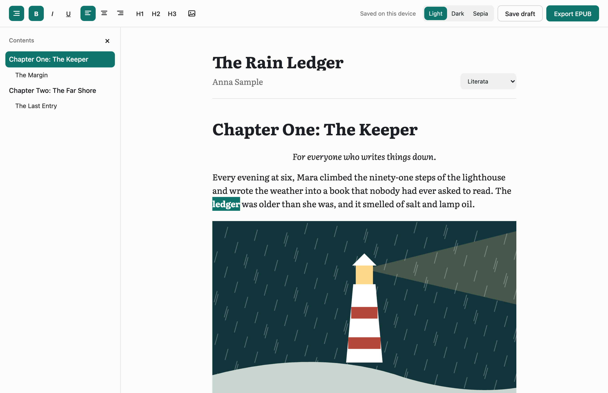

**Try the output:** [`samples/the-rain-ledger.epub`](samples/the-rain-ledger.epub) is a tiny book exported by this editor, with a title, an author, a table of contents, formatting, an illustration and an embedded font. It passes [EPUBCheck](https://www.w3.org/publishing/epubcheck/) with 0 errors and 0 warnings.

## Contents

- [Features](#features)
- [Quick start](#quick-start)
- [What it is built with](#what-it-is-built-with)
- [What ProseMirror does](#what-prosemirror-does)
- [How it works](#how-it-works)
  - [Overview](#overview)
  - [The document](#the-document)
  - [The toolbar](#the-toolbar)
  - [Pasting](#pasting)
  - [Saving drafts](#saving-drafts)
  - [Images](#images)
  - [Fonts](#fonts)
  - [Themes](#themes)
  - [The Contents panel](#the-contents-panel)
  - [EPUB export](#epub-export)
  - [Phones](#phones)
- [Project structure](#project-structure)
- [Connecting the Ruby backend](#connecting-the-ruby-backend)
- [Extending the editor](#extending-the-editor)
- [Testing](#testing)
- [Known limits](#known-limits)
- [Licenses](#licenses)

## Features

### Formatting

Bold, italic, underline; left, center and right alignment; H1, H2 and H3. Everything is available from the toolbar and from the keyboard.

| Action       | Mac   | Windows / Linux |
| ------------ | ----- | --------------- |
| Bold         | ⌘B    | Ctrl+B          |
| Italic       | ⌘I    | Ctrl+I          |
| Underline    | ⌘U    | Ctrl+U          |
| Align left   | ⌘⇧L   | Ctrl+Shift+L    |
| Align center | ⌘⇧E   | Ctrl+Shift+E    |
| Align right  | ⌘⇧R   | Ctrl+Shift+R    |
| H1, H2, H3   | ⌘⌥1–3 | Ctrl+Alt+1–3    |
| Save draft   | ⌘S    | Ctrl+S          |

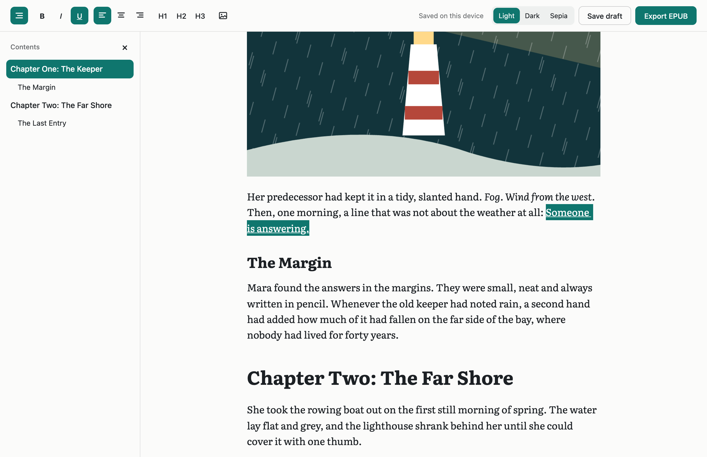

### Phones

Select text, then tap a button. The toolbar moves to the bottom edge, above the keyboard, because the phone's own copy and paste menu appears next to the selection. The selection stays in place after a tap, so several formats can be applied in a row.

<p>
  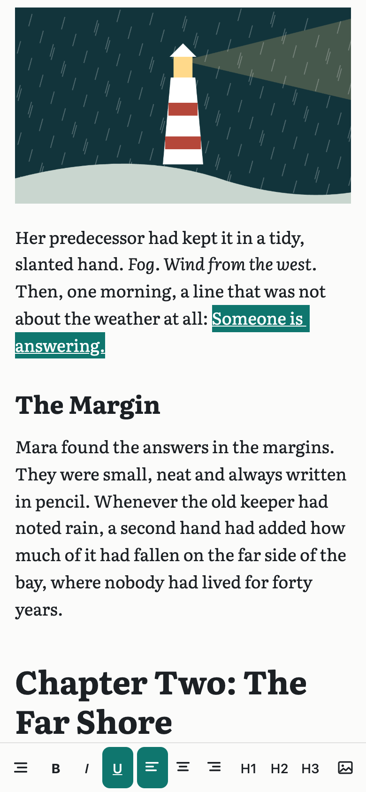
  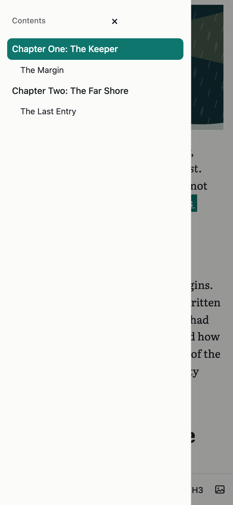
</p>

### Illustrations

Add images with the toolbar button, by pasting, or by dragging them in. Select an image to align it, describe it for screen readers, or remove it.

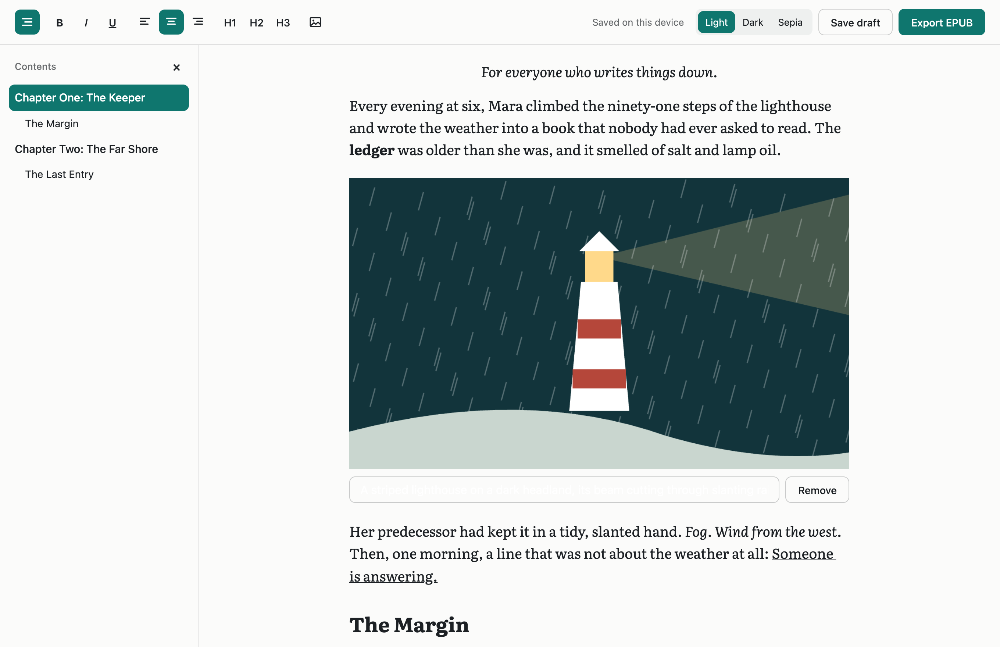

### Table of contents

Any line marked as a heading appears in the Contents panel within about a quarter of a second. An H1 is a chapter; H2 and H3 nest beneath it. Click an entry to jump there. The panel follows the same rules as the EPUB, so it shows what readers will get.

### Fonts

The author picks one font for the whole book. All five are free, cover Latin and Cyrillic, and are embedded in the EPUB.

| Serif    | Sans-serif |
| -------- | ---------- |
| Literata | Inter      |
| Lora     | Open Sans  |
| PT Serif |            |

<p>
  
  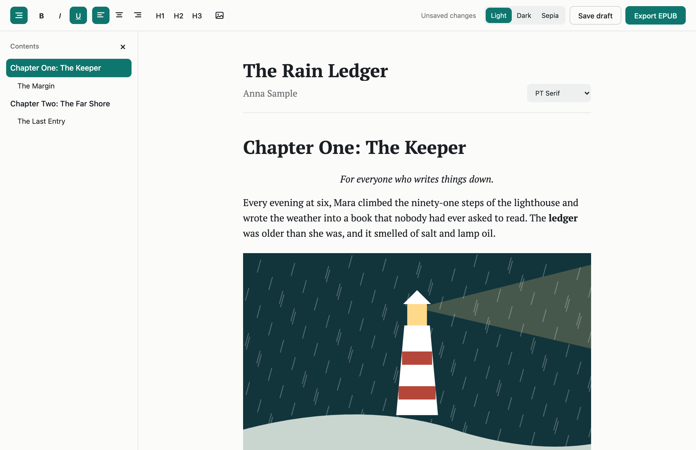
</p>

### Themes

Light, Dark and Sepia. The editor follows the device until the author chooses. All three use a teal accent, adjusted for each theme so that it stays readable.

<p>
  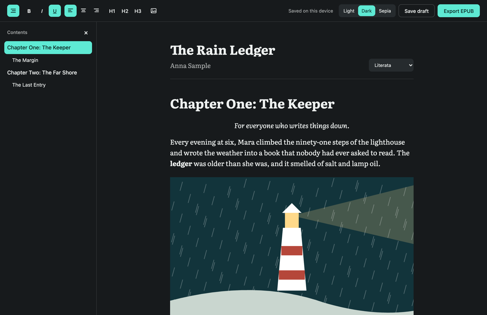
  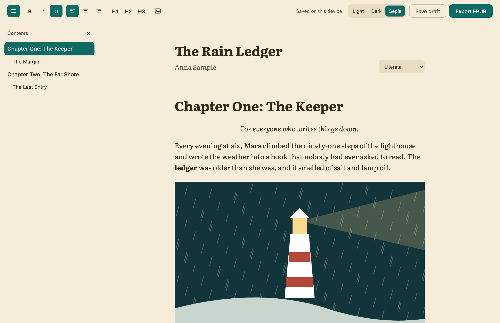
</p>

### EPUB export

One click produces a book with a title page, a Contents page, chapters, images, the chosen font, and title and author metadata. These pages come from the sample book:

<p>
  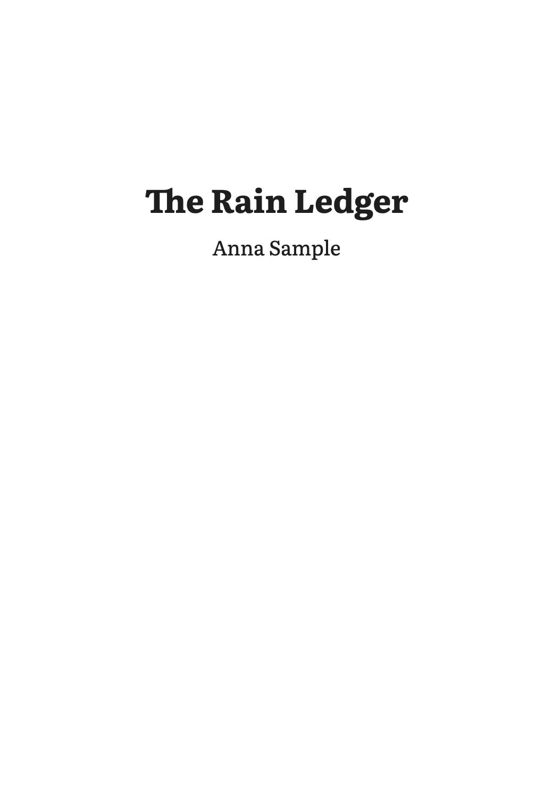
  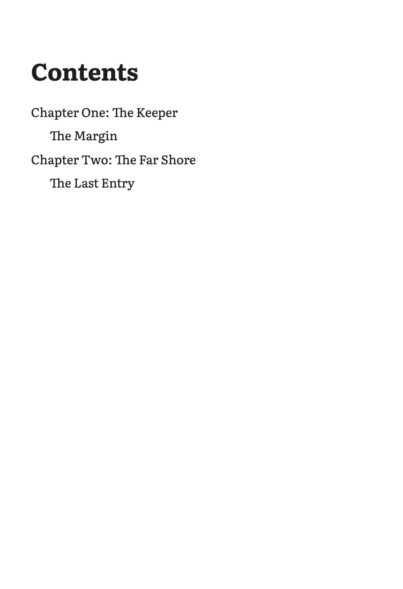
  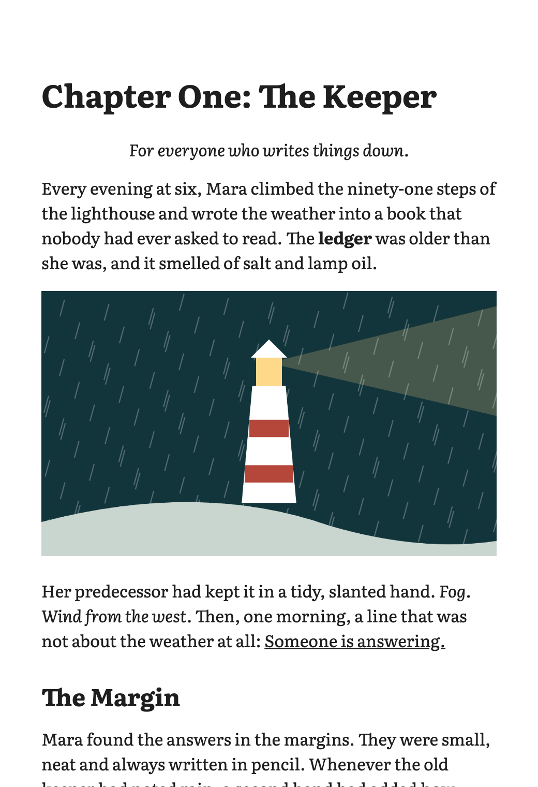
  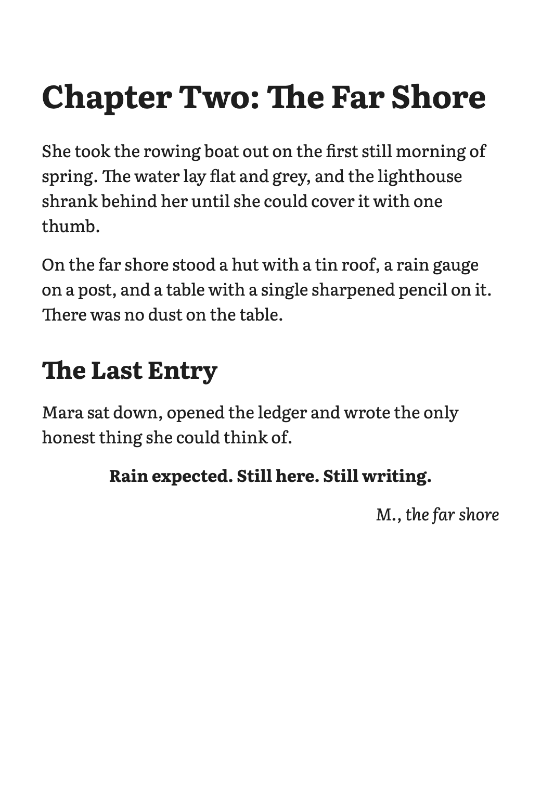
</p>

### Also included

- **Paste** from Word, Google Docs, Pages or the web, keeping the formatting.
- **Drafts** save automatically every 2 seconds, and with Save draft or ⌘S.

## Quick start

Requires Node.js. The project was developed on Node 24.

```bash
npm install
npm run dev
```

Open <http://localhost:3000>.

| Command         | What it does                         |
| --------------- | ------------------------------------ |
| `npm run dev`   | Starts the development server        |
| `npm run build` | Creates a production build           |
| `npm start`     | Serves the production build          |
| `npm test`      | Runs the unit tests                  |
| `npm run lint`  | Runs ESLint                          |

## What it is built with

| Layer            | Technology                                              | Why                                                                     |
| ---------------- | ------------------------------------------------------- | ----------------------------------------------------------------------- |
| App framework    | [Next.js 16](https://nextjs.org), [React 19](https://react.dev) | Fullstack React, with the editor running in the browser                  |
| Editor engine    | [ProseMirror](https://prosemirror.net)                  | Structured documents; handles the hard parts of browser text editing    |
| Editor framework | [Tiptap 3](https://tiptap.dev)                          | Ready-made extensions and React bindings on top of ProseMirror          |
| ZIP              | [fflate](https://github.com/101arrowz/fflate)           | Tiny and fast; an EPUB is a ZIP file                                    |
| Browser storage  | [idb-keyval](https://github.com/jakearchibald/idb-keyval) | A very small wrapper around IndexedDB                                   |
| Fonts            | [Fontsource](https://fontsource.org)                    | Self-hosted font files, available to the EPUB exporter                  |
| Language         | TypeScript                                              |                                                                         |
| Tests            | [Vitest](https://vitest.dev), [jsdom](https://github.com/jsdom/jsdom) | Unit tests                                                              |

**So, is it ProseMirror?** Yes. ProseMirror is the engine, and Tiptap is the layer we use to work with it. Our code talks mostly to Tiptap, and Tiptap drives ProseMirror. Where we need more control, such as pasting and image handling, we use ProseMirror's own `Plugin`, `Slice` and `Transaction` directly.

**Size:** about 318 KB of gzipped JavaScript in total, including React and Next.js. The ZIP code is about 13 KB and downloads only when the author exports. Each font downloads only when it is selected.

There is no CSS framework: styles are plain CSS in two files.

## What ProseMirror does

A plain `contenteditable` element lets the browser edit HTML directly, and each browser produces different HTML. That is unreliable, and it is hard to turn into a book.

ProseMirror keeps the real document in JavaScript, as a tree that follows a strict schema. The DOM is only a view of it.

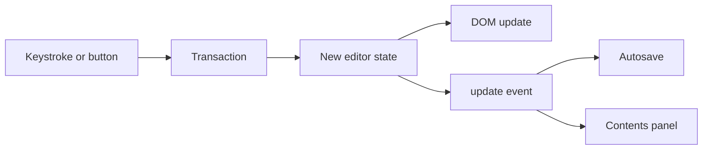

- **Schema:** what a document may contain. If something isn't in the schema, it can't get into the document.
- **State:** the document, the selection and the plugins, as an immutable value.
- **Transaction:** a description of a change. Applying it produces a new state. Undo is built on this.
- **View:** renders the state to the DOM and turns browser events into transactions.

Because the content is a clean tree instead of arbitrary HTML, the EPUB exporter can walk it and write strict XHTML.

Tiptap wraps this model in extensions and a chainable API:

```ts
editor.chain().focus().toggleBold().run();
```

## How it works

### Overview

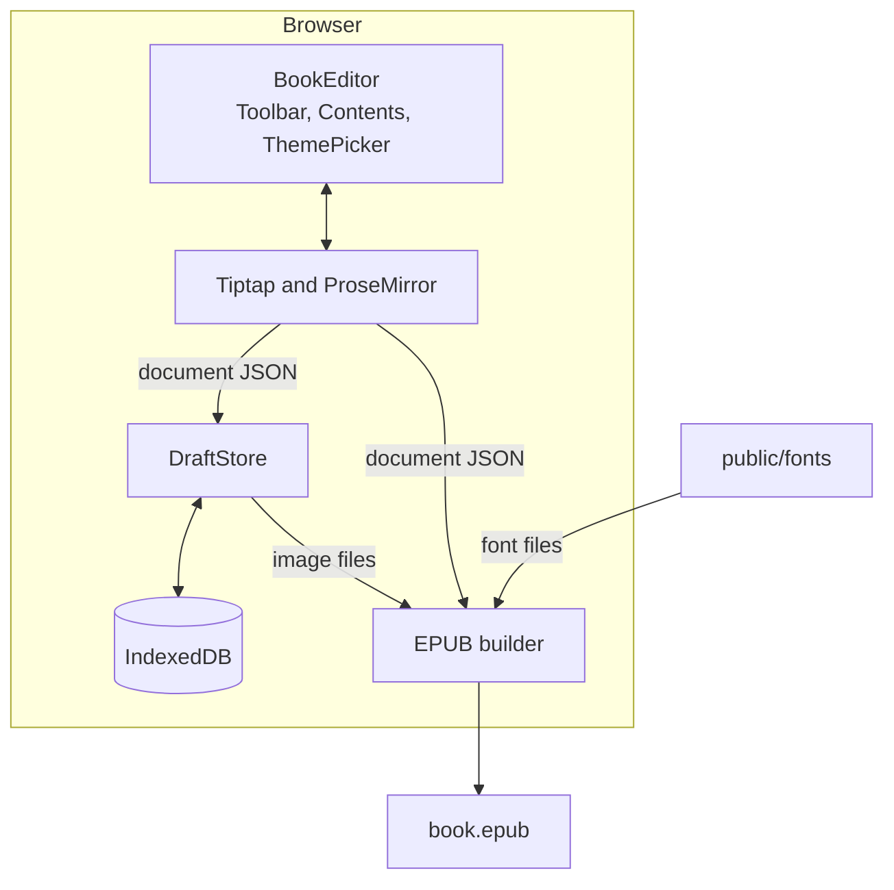

The editor depends on the DOM and IndexedDB, so it never renders on the server. `EditorLoader` loads it with `next/dynamic` and `ssr: false`, and the Next.js page itself stays static.

`BookEditor` first loads the draft, then mounts the workspace with that content. If a draft can't be read, it shows an error and a retry button rather than a blank editor, because the next autosave would overwrite the draft.

### The document

The schema is in [`src/lib/schema.ts`](src/lib/schema.ts). It uses Tiptap's StarterKit limited to three heading levels, the TextAlign extension and our `bookImage` node.

| Kind   | Contents                                                                           |
| ------ | ---------------------------------------------------------------------------------- |
| Blocks | paragraph, heading (1–3), bullet list, ordered list, blockquote, horizontal rule, image |
| Inline | text, hard break                                                                   |
| Marks  | bold, italic, underline, strike, link                                              |

Lists, quotes, rules, links and strikethrough have no toolbar buttons. They exist so that pasted text keeps them.

A saved document is plain JSON:

```json
{
  "type": "doc",
  "content": [
    { "type": "heading", "attrs": { "level": 1, "textAlign": null },
      "content": [{ "type": "text", "text": "Chapter One" }] },
    { "type": "paragraph", "attrs": { "textAlign": "center" },
      "content": [{ "type": "text", "text": "ledger", "marks": [{ "type": "bold" }] }] }
  ]
}
```

### The toolbar

[`Toolbar.tsx`](src/components/editor/Toolbar.tsx) is a list of actions, each with a label, a shortcut, an icon, an `isActive` check and a command. The shortcuts themselves come from the Tiptap extensions.

Two details matter:

- Each button cancels `mousedown`, which keeps the text selection. This is what makes select-then-tap work on phones.
- Button states use `useEditorState` with a selector, so the toolbar re-renders only when a state changes, not on every keystroke.

### Pasting

Clipboard HTML from other apps often keeps formatting in places the editor doesn't look. [`src/lib/paste.ts`](src/lib/paste.ts) fixes that before ProseMirror parses it.

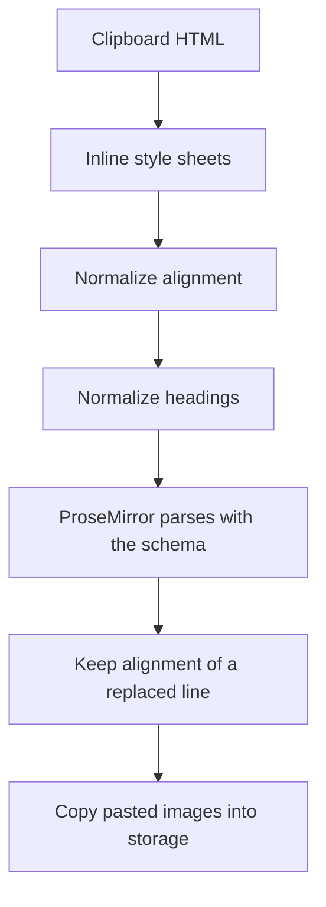

1. **Style sheets:** Word, Pages and TextEdit keep bold, italics and alignment in a `<style>` block, so those rules are copied onto the elements.
2. **Alignment:** the old `align` attribute, `<center>`, and alignment on wrapper elements all move to paragraphs and headings.
3. **Headings:** H4 to H6 become H3. Word's Title and Subtitle styles become H1 and H2.
4. **Schema:** whatever the schema doesn't know, such as fonts, sizes and colors, is dropped. That is deliberate: typography belongs to the book's font and the reader's settings.
5. **Alignment of a replaced line:** ProseMirror normally merges pasted text into the current line, which would lose the pasted alignment. When a paste replaces a whole line, it keeps its own.

### Saving drafts

[`useAutosave.ts`](src/components/editor/useAutosave.ts) tracks whether there are unsaved changes.

- **While typing:** saves every 2 seconds. The timer isn't reset by keystrokes, so an author who never pauses still gets saved.
- **Manually:** the Save draft button and ⌘S.
- **Leaving:** saves when the tab is hidden, because phones can close a hidden tab without warning, and warns about unsaved changes on close.
- **Failures:** the status shows an error and the change stays marked as unsaved.

Drafts use IndexedDB because a long book can outgrow the 5 MB limit of `localStorage`. The screen says "Saved on this device" because that is exactly what is true today.

### Images

Image files don't go inside the document. The document stores an id, and the file sits in a separate IndexedDB database. In our test a draft with two images was 675 bytes, so autosave stays fast however many images a book has.

[`src/lib/images.ts`](src/lib/images.ts) prepares each image before storing it:

- Scales it to at most 1600 px on the longest side.
- Saves it as JPEG or PNG, which every reader supports. WebP is converted, for example.
- Re-encodes it, which removes EXIF data. A phone photo's GPS location must not end up in a published book.
- Keeps a GIF as it is when it is already small enough, so that it stays animated.

[`useImages.ts`](src/components/editor/useImages.ts) handles the ways images arrive:

| Source                                   | What happens                                                                  |
| ---------------------------------------- | ----------------------------------------------------------------------------- |
| Toolbar button, drag and drop            | The files are processed and inserted                                          |
| Pasted screenshot                        | Treated as a file                                                             |
| Paste with both text and an image file   | The text wins: Word offers a picture of the selection alongside its text      |
| `` in pasted HTML                   | Fetched and copied into storage, so the book doesn't depend on another server |
| An image the browser can't fetch         | Removed, and the author is told to add it with the button                     |

After inserting, the caret moves past the image. If the image stayed selected, the next keystroke would replace it.

### Fonts

The font is stored with the draft, as a book setting. [`scripts/copy-fonts.mjs`](scripts/copy-fonts.mjs) copies four styles of each font (regular, italic, bold, bold italic) in Latin and Cyrillic from Fontsource into `public/fonts`. They are served as plain files because the exporter needs the raw bytes.

The editor adds `@font-face` rules for the selected font only. The browser downloads a file when text actually needs it, using `unicode-range`.

### Themes

[`src/lib/theme.ts`](src/lib/theme.ts) defines the themes, and CSS variables in [`globals.css`](src/app/globals.css) define the colors.

The theme is a preference of the browser, not of the book, so it goes in `localStorage` and never reaches the EPUB. A small inline script in `layout.tsx` applies it before the first paint, so a dark page doesn't flash white.

### The Contents panel

[`Contents.tsx`](src/components/editor/Contents.tsx) lists the top-level, non-empty headings. The list is refreshed at most every 250 ms, because reading it means walking the whole document.

- **From 1100 px wide:** it is a sidebar, open by default.
- **Narrower:** it is a drawer that covers the page, closed by default. Tap outside or press Esc to close it.

Clicking an entry moves the selection and scrolls to the heading. On a touch device the editor isn't focused, because that would open the keyboard over the chapter just opened. The highlight follows the caret, not the scroll position.

### EPUB export

Everything is in [`src/lib/epub/`](src/lib/epub). Export runs in the browser, and the code is loaded only when needed.

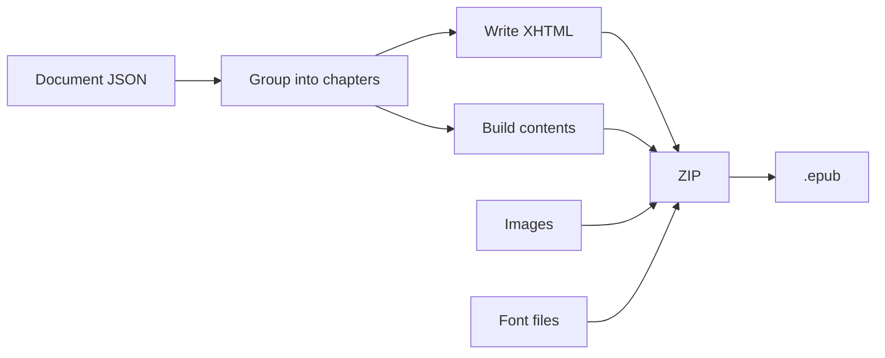

**Writing XHTML:** Tiptap's HTML output isn't valid XML, so [`serialize.ts`](src/lib/epub/serialize.ts) writes pages directly from the JSON. It escapes text, removes characters that are illegal in XML (Word can paste some), and drops unsafe or invalid links.

**Chapters:** [`chapters.ts`](src/lib/epub/chapters.ts) starts a new file at each H1. If a book has no H1, it uses the highest heading level present, so a book that uses H2 for chapters isn't one huge file. Text before the first heading gets its own file, listed under the book's title.

**Inside the file**, using the sample book:

```text
the-rain-ledger.epub
├── mimetype                  must be first and uncompressed
├── META-INF/container.xml    points to content.opf
└── EPUB/
    ├── content.opf           metadata, file list, reading order
    ├── nav.xhtml             contents: EPUB 3 menu and the visible page
    ├── toc.ncx               contents for older EPUB 2 devices
    ├── book.css              fonts and formatting
    ├── title.xhtml           title page
    ├── chapter-001.xhtml
    ├── chapter-002.xhtml
    ├── fonts/*.woff2
    └── images/*.png
```

**Table of contents:** it reaches the reader in three ways, all built from the same headings:

| Form                 | File        | Where it shows up                                       |
| -------------------- | ----------- | ------------------------------------------------------- |
| Contents page        | `nav.xhtml` | In the book, after the title page, with working links   |
| EPUB 3 navigation    | `nav.xhtml` | The contents menu of modern reading apps                |
| NCX                  | `toc.ncx`   | The contents menu of older e-readers                    |

The visible page is left out when there is only one entry.

**Metadata:** written to `content.opf`.

| Field                | Source                                                         |
| -------------------- | -------------------------------------------------------------- |
| `dc:title`           | The Book title field, or `Untitled` if it is blank             |
| `dc:creator`         | The Author field, tagged with the `aut` role; left out if blank |
| `dc:language`        | `ru` if the text is mostly Cyrillic, otherwise the browser's language |
| `dc:identifier`      | A permanent id created with the draft                          |
| `dcterms:modified`   | The time of export                                             |

Exporting without a title or an author shows a notice. The title and author also go into the title page and `toc.ncx`.

**Styling:** `book.css` sets margins and alignment, and leaves sizes to the reader's settings. Fonts are embedded only for the character sets a book uses, which adds about 90 KB for Latin and 140 KB with Cyrillic.

### Phones

Below 768 px, the toolbar is fixed to the bottom edge. Android resizes the page for the keyboard, thanks to `interactive-widget=resizes-content`. iOS draws the keyboard over the page instead, so [`useKeyboardOffset.ts`](src/components/editor/useKeyboardOffset.ts) reads the `visualViewport` API and lifts the toolbar by hand.

## Project structure

```text
src/
├── app/
│   ├── layout.tsx             viewport settings and the theme script
│   ├── page.tsx               the page
│   └── globals.css            colors for each theme
├── components/editor/
│   ├── BookEditor.tsx         loads the draft; the main screen; export
│   ├── EditorLoader.tsx       browser-only loading
│   ├── Toolbar.tsx            formatting buttons
│   ├── Contents.tsx           the Contents panel
│   ├── ThemePicker.tsx        Light / Dark / Sepia
│   ├── BookImage.tsx          the image node and its view
│   ├── useAutosave.ts         saving
│   ├── useImages.ts           file, paste and drop handling
│   ├── useKeyboardOffset.ts   toolbar above the iOS keyboard
│   ├── useNotice.ts           temporary status messages
│   └── editor.css             editor styles
└── lib/
    ├── schema.ts              what a document can contain
    ├── paste.ts               pasted HTML cleanup
    ├── drafts.ts              DraftStore and browser storage
    ├── images.ts              image processing
    ├── fonts.ts               available fonts and how they load
    ├── headings.ts            heading list for the Contents panel
    ├── theme.ts               themes and the early script
    └── epub/
        ├── index.ts           builds the EPUB
        ├── chapters.ts        chapters and the table of contents
        ├── serialize.ts       document JSON to XHTML
        └── styles.ts          the book's stylesheet
scripts/
├── copy-fonts.mjs             copies fonts into public/fonts
└── capture-docs.mjs           regenerates the sample and screenshots
```

## Connecting the Ruby backend

The editor only talks to the `DraftStore` interface in [`src/lib/drafts.ts`](src/lib/drafts.ts):

```ts
export interface DraftStore {
  load(id: string): Promise<Draft | null>;
  save(draft: Draft): Promise<void>;
  loadImage(id: string): Promise<Blob | null>;
  saveImage(id: string, image: Blob): Promise<void>;
}
```

To store drafts on the server, implement it over your API and pass it in. No editor code changes. This sketch uses example endpoints:

```ts
const railsDraftStore: DraftStore = {
  load: async (id) => {
    const response = await fetch(`/api/drafts/${id}`);
    if (response.status === 404) return null;
    if (!response.ok) throw new Error("Couldn't load the draft");
    return response.json();
  },
  save: async (draft) => {
    const response = await fetch(`/api/drafts/${draft.id}`, {
      method: "PUT",
      headers: { "Content-Type": "application/json" },
      body: JSON.stringify(draft),
    });
    if (!response.ok) throw new Error("Couldn't save the draft");
  },
  loadImage: async (id) => {
    const response = await fetch(`/api/images/${id}`);
    return response.ok ? response.blob() : null;
  },
  saveImage: async (id, image) => {
    const response = await fetch(`/api/images/${id}`, { method: "PUT", body: image });
    if (!response.ok) throw new Error("Couldn't save the image");
  },
};
```

```tsx
<BookEditor draftId={book.id} store={railsDraftStore} />
```

`load` must throw on a real failure instead of returning `null`. `null` means "no such draft" and starts a blank one, which the next autosave would save over the existing draft.

On the Rails side, `content` can be stored as `jsonb` as it is. Images need an upload endpoint, and Active Storage would suit that. A real backend should also handle two tabs editing the same draft, which is last-save-wins today.

## Extending the editor

**Add a font:** add it to `scripts/copy-fonts.mjs`, run `node scripts/copy-fonts.mjs`, and add it to `FONTS` in [`src/lib/fonts.ts`](src/lib/fonts.ts).

**Add a formatting option:** add the action to `GROUPS` in `Toolbar.tsx`.

**Add a new kind of content:** add the extension to `src/lib/schema.ts` **and** a case to `serializeNode` in `src/lib/epub/serialize.ts`. Without that case, the node's own formatting is lost in the EPUB.

**Regenerate the sample and screenshots:** this drives the real app in a temporary Chrome profile, so it can't touch your own draft.

```bash
npm run build
npx next start -p 3200
```

Then, in a second terminal:

```bash
node scripts/capture-docs.mjs
```

Set `CHROME` if Chrome isn't in the default macOS location, and `APP_URL` if the app runs elsewhere.

## Testing

`npm test` runs 23 unit tests covering paste cleanup, the heading list, and the EPUB builder: file structure, formatting, chapters, table of contents links, metadata, images, fonts and escaping.

Beyond those, each feature was exercised in a real browser during development, and exported files were checked with EPUBCheck 5.2.1.

**Measured on an Apple Silicon Mac, with a 150,000-word book of about 20,000 paragraphs:**

| Operation             | Time           |
| --------------------- | -------------- |
| Pasting the whole book | About 4.5 s   |
| Saving the draft      | About 0.2 s    |
| Exporting the EPUB    | About 0.6 s    |
| Editor work per keystroke | About 40 ms |

Typing cost grows with the number of paragraphs: it was about 27 ms at half that length. Expect slower numbers on a phone.

**Not verified yet:**

- Real iPhones and Android phones. Phone layouts were tested in browser emulation, and the iOS keyboard handling with a simulated keyboard height.
- Real pastes from Word, Google Docs and Pages. Paste handling was tested with HTML shaped like theirs.
- Real e-readers and reading apps. EPUB output was validated with EPUBCheck and viewed in a browser.
- Drag and drop of image files.

## Known limits

- **One draft per browser.** The code is keyed by draft id, but there is no library screen yet.
- **Drafts stay on one device** until a backend is connected. Clearing browser data deletes them.
- **No files can be opened.** Text comes in by typing or pasting.
- **Very long books on phones** may feel slow, because ProseMirror's update cost grows with the number of top-level paragraphs. Editing one chapter at a time would solve it.
- **Images fetched during paste** can fail, because many sites and apps don't allow it. The author is told when that happens.
- **Removed images stay in browser storage** so that undo works. They aren't cleaned up yet.
- **SVG isn't supported.** Formats a browser can't read, such as HEIC in Chrome, are refused with a message.
- **One author field.** Co-authors are saved as a single name.
- **No cover image** in the EPUB yet.
- **Readers may override the font.** That is normal for EPUB, and some ignore embedded fonts.

## Licenses

The five fonts are licensed under the [SIL Open Font License 1.1](https://openfontlicense.org), which allows embedding them in books. Each font's license is in its folder in `public/fonts/`.

*The Rain Ledger* and its illustration are original sample content made for this project. Anna Sample is a fictional author.

This project has no license of its own yet.
